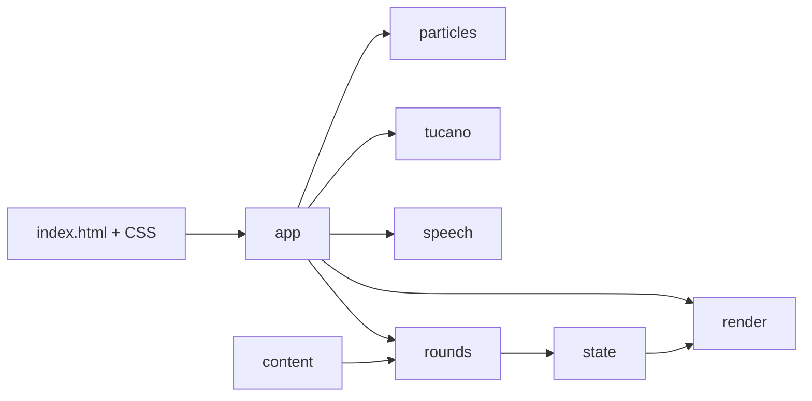

# Design — Arquitetura modular estática

**Versão**: 2.0.0 · **Data**: 2026-10-04

## Fontes por domínio

[spec.md](spec.md) reúne objetivos e FR. Os detalhes estão em [cenas](scene-spec.md), [ator](character-spec.md), [animações](animation-spec.md), [ambiente](environment-spec.md), [regras](rules-spec.md), [conteúdo](content-spec.md), [estado](state-spec.md) e [áudio](audio-spec.md). Este documento define integração, sem repetir layouts, tabelas de conteúdo ou mensagens.

## Arquivos e limites

| Caminho relativo a `apps/alfabeto-divertido/` | Responsabilidade |
| --- | --- |
| `index.html` | Shell único, metadados, três telas, regiões acessíveis, SVG inline, links e bootstrap declarativo |
| `styles/base.css` | Reset, elementos nativos, foco e utilitários acessíveis |
| `styles/theme.css` | Tokens, fonte local, cores e fundo |
| `styles/components.css` | Layout, componentes, estados estáticos, ator e responsividade |
| `styles/animations.css` | Transições, keyframes, efeitos e movimento reduzido |
| `js/data/content.js` | Dados imutáveis compartilhados, sem DOM |
| `js/core/state.js` | Sessão autoritativa e temporizadores, sem DOM/áudio |
| `js/game/rounds.js` | Sorteio, alternativas, ocorrências, decisões e pontuação, sem DOM/áudio |
| `js/game/render.js` | DOM, foco, progresso, componentes e callbacks de entrada |
| `js/audio/speech.js` | Voz brasileira local, efeitos sonoros e cancelamento |
| `js/actors/tucano.js` | Reações e balões de Rômulo Penha |
| `js/effects/particles.js` | Emoji, flash e partículas limitadas e descartáveis |
| `js/app.js` | Composição dos serviços, ações, navegação e ciclo de vida |

Não criar arquivos por botão ou por pequena função, framework, servidor, build, roteador, barramento de eventos ou carregador customizado. Separar responsabilidades por módulos coesos. Somente app coordena os domínios; regras nunca consultam classes CSS e áudio nunca altera resultados.

## Carregamento e dependências

CSS declara `@layer base, theme, components, animations`. HTML carrega esses quatro arquivos nessa ordem. Scripts externos clássicos `defer` são carregados na ordem conteúdo → estado → regras → áudio → ator → efeitos → renderização → app. IIFEs isolam variáveis e publicam somente o namespace `window.AlfabetoDivertido`. Não há CSS/JS embutido no HTML nem `type="module"`; a decisão de compatibilidade com `file://` está em [research.md](research.md).

App instancia estado, áudio, ator, efeitos e renderer uma vez; entrega callbacks de ações ao renderer. Renderer valida o contexto da entrada, app chama regras, regras alteram estado e retornam resultado; renderer apresenta o resultado. Factory de áudio avisa falha por callback, deixando a alteração de `aria-live` com renderer. Ator e efeitos usam temporizadores da sessão. Estado permanece em memória; não há contas ou persistência.

## Fluxo de processamento e proteção contra ações antigas

1. Receber a ação e verificar tela, modo, questão atual, conclusão e disponibilidade do botão.
2. Avaliar a letra pelas regras de [data-model.md](data-model.md).
3. Alterar estado uma única vez; depois atualizar tela, feedback, ator e áudio.
4. Se a questão terminou, bloquear novas respostas e agendar somente um avanço.
5. Ao sair, reiniciar ou trocar de modo, invalidar o identificador da atividade anterior, cancelar espera de avanço, fala, balão e efeitos.
6. Antes de executar qualquer ação atrasada ou retorno de fala, confirmar que a atividade e a seleção ainda são as mesmas.

O encadeamento de fala do alfabeto usa o término da letra, e não um atraso fixo de 800 ms. Uma falha de fala encerra a sequência sem travar controles. O mute interrompe também sons já agendados e não somente os próximos. O controle de som existe nas três telas, inclusive na celebração.

## Distribuição e validação

Distribuir a pasta inteira mantendo caminhos relativos; abrir `index.html` sem servidor. Mudança de formato justifica versão 2.0.0. Testes são ferramentas externas, não distribuídas com o jogo. Evidências novas ficam em `tests/evidence/modular/`; resultados da versão 1.0.0 permanecem históricos. Ver [validation.md](validation.md) e [quickstart.md](quickstart.md).
