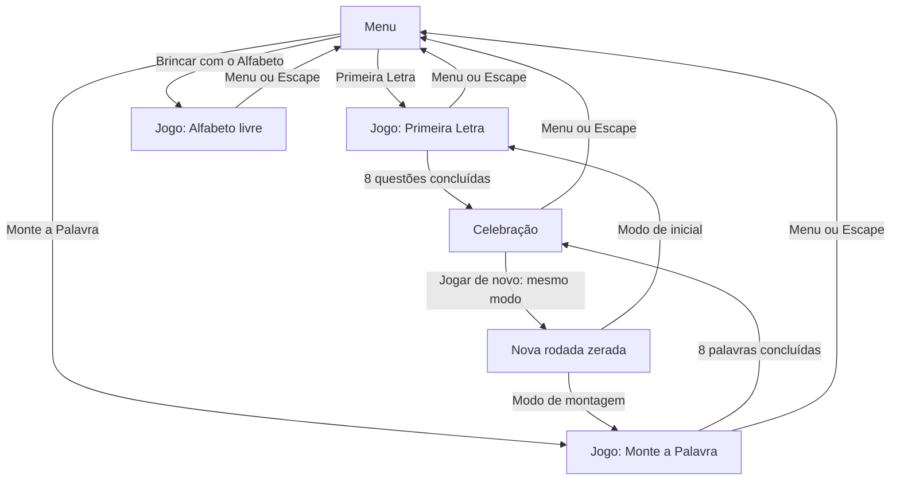

# Cenas e navegação — Alfabeto Divertido

**Versão**: 2.0.0 · **Data**: 2026-10-04

**Autor do jogo**: Rômulo Penha.

Fonte normativa deste domínio. Requisitos gerais em [spec.md](spec.md); integração em [Design.md](Design.md). Conteúdo transferido da referência anterior, sem alterar as regras.

## Mapa de telas e navegação

Existem três telas físicas: menu, jogo e celebração. Os três modos ocupam a mesma tela de jogo, substituindo o conteúdo central. Nenhuma navegação muda de arquivo ou endereço.

## Rodapé compartilhado — autoria

Exibir no rodapé de todas as telas o crédito **Jogo desenvolvido por “Rômulo Penha”**. Usar um único elemento semântico `footer`, fora das telas substituídas, em fluxo normal da página. Centralizar o crédito no mesmo eixo do conteúdo, com margens e preenchimento laterais simétricos. Apresentar um cartão discreto e arredondado, com fundo branco translúcido, a frase na primeira linha e o nome em destaque na segunda. O texto deve ser legível e acessível em telas estreitas. No jogo e na celebração, reservar espaço abaixo do crédito para o mascote e seu balão; no menu, usar rodapé compacto. Não deslocar o crédito horizontalmente para compensar o mascote. Não criar botão, link, anúncio automático ou fala para o crédito.

Esta seção é a fonte normativa da autoria e do crédito de desenvolvimento. A identidade do ator permanece em [character-spec.md](character-spec.md).

## Tela 1 — Menu

| Região | Conteúdo e comportamento |
| --- | --- |
| Topo direito | Controle 🔊/🔇, com nome acessível e estado ligado/desligado |
| Centro superior | “Alfabeto Divertido”, com destaque amarelo em “Divertido” |
| Abaixo do título | “Vamos aprender a ler brincando! 🎉” |
| Centro | Três botões grandes em coluna, com largura máxima aproximada de 460 px |
| Botão rosa | 🔤 Primeira Letra — “Qual letra começa a palavra?” |
| Botão turquesa | 🧩 Monte a Palavra — “Coloque as letras na ordem” |
| Botão roxo | 🎨 Brincar com o Alfabeto — “Toque em cada letra e ouça” |
| Mascote | Escondido, conforme a referência |

Ao abrir o arquivo, o menu aparece sem fala automática obrigatória. A ordem de leitura é título, orientação, modos e controle de som; a ordem de foco deve ser previsível. Voltar de uma atividade coloca o foco no botão do modo usado anteriormente.

## Tela 2 — Jogo: estrutura comum

Área central com largura máxima aproximada de 900 px. O cabeçalho apresenta botão 🏠 à esquerda, progresso no centro nos modos avaliados e som à direita. Pergunta, imagem, respostas e feedback ficam no fluxo de leitura do conteúdo central.

O rodapé reserva espaço para Rômulo Penha. Essa área pertence ao layout, mesmo que o tucano seja posicionado no canto inferior esquerdo da janela. A camada do mascote não captura interação.

### Estado inicial da questão

- Pergunta visível com destaque na palavra.
- Emoji grande sem reação de erro ou acerto herdada.
- Respostas ou letras disponíveis e feedback anterior limpo.
- Indicador atual destacado; barra mostra somente questões já concluídas.
- Foco no título da atividade ou da pergunta, com estratégia que não duplique sua leitura.
- Narração da pergunta após a entrada, se som e voz estiverem disponíveis.

### Primeira Letra

| Ordem visual | Componente |
| --- | --- |
| 1 | “Qual é a primeira letra de {PALAVRA}?” |
| 2 | Emoji da palavra, com tamanho adaptável, aproximadamente 80–160 px |
| 3 | Pista “?{RESTO DA PALAVRA}”, por exemplo ?ATO |
| 4 | Três botões de letras distintas, grandes, coloridos e com olhos |
| 5 | Região de feedback com altura reservada para evitar saltos do layout |

**Acerto**: preencher a inicial da pista, destacar o botão correto e apresentar mensagem positiva. Desabilitar as três opções até o avanço, aproximadamente 1,6 s depois. O estado visual do acerto dura até a questão seguinte.

**Erro**: manter as opções disponíveis, animar brevemente o botão e o emoji, apresentar a mensagem de nova tentativa e atualizar o balão do tucano. Não avançar. Se a criança acertar imediatamente depois, o feedback correto prevalece sobre qualquer limpeza atrasada do erro.

### Monte a Palavra

| Ordem visual | Componente |
| --- | --- |
| 1 | “Monte a palavra: {PALAVRA}” |
| 2 | Emoji da palavra |
| 3 | Três ou quatro espaços alinhados; somente o próximo vazio destacado |
| 4 | Letras da palavra embaralhadas, com botões separados para repetições |
| 5 | Região de feedback |

Espaços de aproximadamente 58–86 px, reduzidos proporcionalmente para palavras de quatro letras em telas estreitas. A sequência visual não deve partir a palavra em duas linhas quando houver espaço para mantê-la inteira; diminuir tamanhos antes de recorrer à quebra.

**Encaixe correto**: preencher o próximo espaço com amarelo, animar o encaixe e manter o botão usado na posição original com aparência atenuada e estado desabilitado. Assim, as outras letras não mudam inesperadamente de posição.

**Erro**: não preencher, não consumir botão e não reordenar letras. Reforçar a próxima posição com instrução textual. Um encaixe correto posterior substitui o erro por incentivo coerente.

**Palavra completa**: feedback de sucesso, emoji feliz, todos os botões indisponíveis, progresso atualizado e avanço após aproximadamente 1,8 s.

### Brincar com o Alfabeto

| Região | Conteúdo |
| --- | --- |
| Cabeçalho | Menu, identificação do modo livre e som; sem progresso de rodada |
| Carta de exemplo | Inicialmente orientação; após escolha, letra grande, emoji e palavra |
| Grade | A–Z em ordem; número de colunas adaptável ao espaço |
| Orientação | “Toque em uma letra para ouvir 👇” |
| Mascote | Rômulo Penha reage à letra escolhida |

A grade não depende de altura fixa para mostrar todas as letras. Em celular, a página pode rolar verticalmente. A seleção mais recente atualiza a carta, encerra a fala anterior e inicia letra + exemplo em sequência. Somente a seleção atual mantém indicação de selecionada; o brilho é temporário. Repetir a mesma letra permite ouvi-la novamente.

## Tela 3 — Celebração

| Ordem visual | Componente |
| --- | --- |
| Topo direito | Controle 🔊/🔇 visível e acessível, compartilhando o estado do menu e do jogo |
| 1 | Três estrelas grandes; somente as conquistadas destacadas |
| 2 | Título correspondente à quantidade de estrelas |
| 3 | Mensagem do catálogo abaixo |
| 4 | Botões “🔁 Jogar de novo” e “🏠 Menu”, com quebra para coluna quando necessário |
| Canto inferior esquerdo | Rômulo Penha feliz com balão de celebração |

As estrelas podem aparecer progressivamente, em intervalos aproximados de 0,25 s. O resultado acessível deve anunciar “{N} de 3 estrelas” uma única vez. Não expor cinco repetições do resultado por meio do título, partículas, mascote e estrelas. O foco deve chegar ao título e depois permitir alcançar as ações.

## Componentes e acessibilidade

| Componente | Contrato visual e acessível |
| --- | --- |
| Botão de modo | Ícone decorativo, nome e descrição legíveis; foco visível |
| Botão de som | Nome que descreve a ação e estado atual; sincronizado entre telas |
| Botão de menu | Nome acessível “Voltar ao menu”; disponível durante jogo e celebração |
| Botão de letra | Nome da letra, estado disponível/usado/selecionado e ativação nativa por teclado |
| Espaço da palavra | Posição e conteúdo compreensíveis; não entra na ordem de foco por ser decorativo |
| Progresso | Oito indicadores rotulados e barra de 0 a 8; conclusão e tentativa não dependem só de cor |
| Feedback | Região de anúncio moderado para resultado e orientação; sem anunciar partículas |
| Tela inativa | Não interativa, fora da ordem de foco e da árvore acessível enquanto oculta |
| Emoji | Decorativo quando a palavra já fornece o significado; sem leitura duplicada |

Leitores de tela continuam recebendo feedback com som desligado. A implementação deve coordenar foco, região de anúncio e narração para evitar repetição da mesma instrução; validar com leitor de tela real. Textos e botões mantêm zoom livre; não bloquear seleção ou ampliação globalmente.

## Responsividade e espaço para o ator

| Faixa | Decisão de layout |
| --- | --- |
| Até 420 px | Margens de 12 px, letras e espaços menores; tucano de aproximadamente 72–80 px; área inferior reservada ao balão e ao corpo |
| 421–900 px | Conteúdo central fluido; tucano próximo do tamanho original de 96 × 104 px |
| Acima de 900 px | Conteúdo limitado a 900 px; menu limitado a 460 px; manter composição central |
| Paisagem com pouca altura | Permitir rolagem; compactar intervalos e imagem antes de reduzir legibilidade |
| Zoom de 200% | Reorganizar colunas e botões; nenhum controle depende de altura fixa da janela |

A reserva inferior deve considerar a altura combinada do corpo e do balão visível. O último controle e o feedback precisam poder ser rolados para uma posição sem sobreposição. `pointer-events: none` sozinho não resolve ocultação visual.

### Catálogo de textos e narração

Os textos principais abaixo DEVEM manter o conteúdo da referência. Campos entre chaves são substituídos pelo conteúdo da questão ou da letra. Ajustes de capitalização na fala são permitidos para pronúncia, preservando a palavra apresentada.

| Contexto | Texto visual | Narração com som disponível |
| --- | --- | --- |
| Menu | Alfabeto Divertido | Não exige fala automática |
| Subtítulo | Vamos aprender a ler brincando! 🎉 | Não exige fala automática |
| Modo 1 | 🔤 Primeira Letra / Qual letra começa a palavra? | Pergunta da primeira questão |
| Modo 2 | 🧩 Monte a Palavra / Coloque as letras na ordem | Instrução da primeira questão |
| Modo 3 | 🎨 Brincar com o Alfabeto / Toque em cada letra e ouça | Fala após a escolha de uma letra |
| Questão de inicial | Qual é a primeira letra de {PALAVRA}? | Qual é a primeira letra de {PALAVRA}? |
| Acerto de inicial | 🎉 {LETRA} de {PALAVRA}! | {LETRA}. {PALAVRA}! Muito bem! |
| Erro de inicial | Quase! Tente outra letra 🤔 | Quase! Tente de novo. |
| Questão de montagem | Monte a palavra: {PALAVRA} | Monte a palavra {PALAVRA}. |
| Palavra concluída | 🎉 Isso! {PALAVRA}! | {PALAVRA}! Muito bem! |
| Erro de montagem | A próxima letra é outra. Tente de novo 🤔 | Tente outra letra. |
| Orientação do alfabeto | Toque em uma letra para ouvir 👇 | Não exige fala automática |
| Letra do alfabeto | {LETRA}, {EMOJI}, {EXEMPLO} | Primeiro {LETRA}; depois {LETRA} de {EXEMPLO} |
| Celebração com 3 estrelas | Uau! Que incrível! / Você acertou quase tudo de primeira. Que memória boa! | Uau! Que incrível! |
| Celebração com 2 estrelas | Muito bem! / Você está aprendendo muito rápido! | Muito bem! Parabéns! |
| Celebração com 1 estrela | Boa! Continue! / Cada tentativa te deixa mais forte. Vamos de novo? | Muito bem! Parabéns! |
| Ações finais | 🔁 Jogar de novo / 🏠 Menu | Não exige fala automática |

## Implementação e validação

`index.html` mantém o shell das três telas. `js/game/render.js` gera o conteúdo, foco, componentes e estados acessíveis. `js/app.js` coordena navegação. Ver [contratos DOM](contracts/ui-contract.md) e casos de fluxo em [validation.md](validation.md). Esta spec define composição e textos; regras de resposta pertencem a [rules-spec.md](rules-spec.md).
