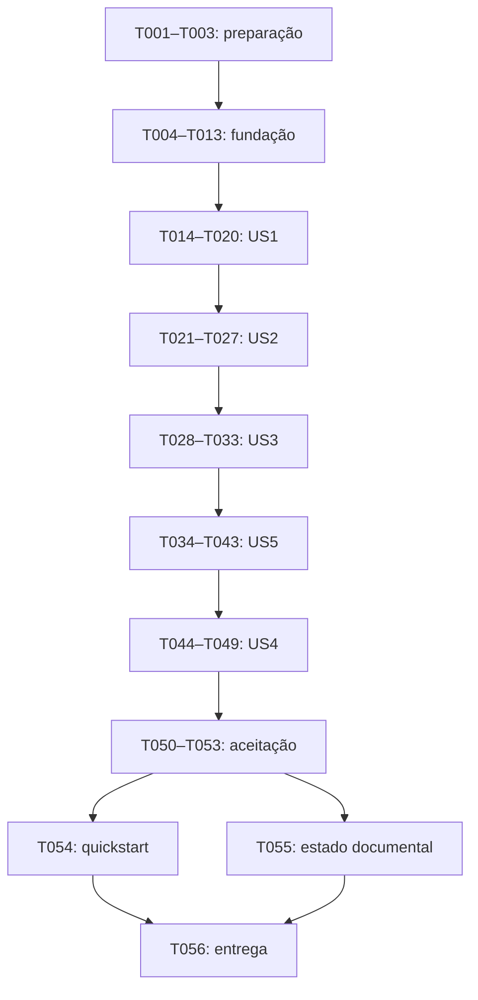

# Tasks: Alfabeto Divertido

**Input**: [SPEC](spec.md), [Design](Design.md), [plano](plan.md), [pesquisa](research.md), [modelo](data-model.md), [contratos](contracts/ui-contract.md) e [validação](validation.md).

**Estado**: Implementação executada; checkboxes indicam trabalho realmente concluído. Aceite manual pendente.

**Tests**: Testes de regras e integração antes da implementação, conforme a constituição. O arquivo futuro `tests/alfabeto.spec.mjs` é ferramenta de desenvolvimento, não parte do jogo distribuído.

## Formato e caminhos

Cada tarefa tem checkbox, ID sequencial, história quando aplicável e caminho de arquivo. `[P]` indica trabalho em arquivos distintos sem dependência mútua, após os pré-requisitos. As alterações em `apps/alfabeto-divertido/index.html` e na suíte única de testes são sequenciais.

`apps/alfabeto-divertido/index.html` e `tests/alfabeto.spec.mjs` são caminhos relativos à raiz do projeto e já foram criados. Os caminhos `specs/001-alfabeto-divertido/...` apontam para a documentação. Na versão 2.0.0, o HTML é a entrada única, com recursos locais em `styles/` e `js/`; testes e evidências continuam externos ao jogo.

**Histórico de execução 1.0.0**: T001–T056 abaixo preservam o escopo e o registro original do HTML embutido. A refatoração autorizada substitui sua arquitetura pelas tarefas T057–T063; marcações antigas não constituem validação da versão nova.

## Phase 1 — Setup

**Objetivo**: Preparar validação sem alterar o contrato de entrega.

- [X] T001 Conferir a referência, as decisões e o limite de um HTML em specs/001-alfabeto-divertido/plan.md antes de iniciar código; registrar qualquer divergência real no documento.
- [X] T002 Registrar máquina de referência (CPU, RAM, sistema e energia), navegadores/versões, runner Playwright e configuração PERF-01 em specs/001-alfabeto-divertido/validation.md antes da execução; não adicionar dependência ao futuro apps/alfabeto-divertido/index.html.
- [X] T003 Criar a base futura de testes em tests/alfabeto.spec.mjs para abertura file://, captura de console/rede, sorteio determinístico e simulação de APIs antes do script da página.

**Checkpoint**: Ambiente de desenvolvimento registrado; nenhum teste ou recurso de automação embutido na interface infantil.

## Phase 2 — Foundational

**Objetivo**: Estabelecer as responsabilidades comuns a todas as histórias.

- [X] T004 Escrever primeiro, em tests/alfabeto.spec.mjs, testes unitários de 8 questões distintas, 3 alternativas distintas, acertos de primeira de 0 a 8, consumo de ocorrências repetidas e invalidação de callbacks; observar falha inicial antes de T006–T013.
- [X] T005 Escrever primeiro, em tests/alfabeto.spec.mjs, testes integrados da fundação para menu → 8 iniciais → celebração, voz local/remota/ausente/tardia, falha de APIs, mute com fontes ativas/agendadas nas três telas, foco oculto, movimento reduzido e saída durante avanço; observar falha inicial antes de T006–T013 e manter falhas esperadas dos modos ainda não implementados identificadas.
- [X] T006 Criar em apps/alfabeto-divertido/index.html a estrutura PT-BR, viewport com zoom permitido, estilos/script internos, três telas e regiões acessíveis, sem fontes ou recursos externos.
- [X] T007 Incorporar em apps/alfabeto-divertido/index.html os 29 pares de palavras, os 26 exemplos, as mensagens e o nome Rômulo Penha, com total fixo de 8 questões; conferir com specs/001-alfabeto-divertido/spec.md.
- [X] T008 Implementar em apps/alfabeto-divertido/index.html regras testáveis de sorteio sem repetição, resultado único por questão e estrelas de 0–4 = 1, 5–7 = 2, 8 = 3; não inferir pontuação de classes visuais; registrar versão semântica do artefato conforme a constituição.
- [X] T009 Implementar em apps/alfabeto-divertido/index.html estado autoritativo de sessão, rodada e seleção, com índice ativo de 0 a 7, acertosDePrimeira de 0 a 8 e conclusão que só ocorre uma vez.
- [X] T010 Implementar em apps/alfabeto-divertido/index.html navegação, invalidação de atividade e cancelamento de avanço, balão, partículas, fala e sons; ignorar callbacks de sessão anterior.
- [X] T011 Definir em apps/alfabeto-divertido/index.html componentes comuns de foco, botões, feedback, 8 indicadores e barra de k/8, com telas inativas fora da interação e da árvore acessível.
- [X] T012 Implementar em apps/alfabeto-divertido/index.html serviços opcionais de áudio com detecção, controle de fontes ativas/agendadas, voz local pt-BR e fallback; nenhum erro de áudio pode bloquear o jogo.
- [X] T013 Criar em apps/alfabeto-divertido/index.html celebração mínima, cálculo de resultado e controle de som visível/acessível nessa tela, mais SVG inline de Rômulo Penha e base de reações/balão, mantendo mascote escondido no menu.

**Checkpoint**: T004–T005 foram escritos e falharam antes do código; testes unitários das unidades disponíveis passam. Testes integrados completos de modos ainda inexistentes permanecem com falha esperada registrada até suas fases, sem bloquear sua implementação nem serem marcados como aprovados. A conclusão de T004/T005 significa testes escritos e falha inicial observada, não aprovação de todas as histórias.

## Phase 3 — US1: Primeira Letra (P1)

**Objetivo**: Oferecer a primeira atividade completa. **Independent Test**: V003–V005 e V008, mais os recortes de V001, V002, V006, V007, V009 e V019 exclusivamente em menu/Primeira Letra/celebração disponíveis; não exigir outros modos antes de suas fases.

- [X] T014 [US1] Acrescentar primeiro em tests/alfabeto.spec.mjs os casos V003–V005 e V008: pergunta, pista, distratores, erro seguido de acerto e acionamento duplicado.
- [X] T015 [US1] Renderizar em apps/alfabeto-divertido/index.html pergunta, emoji, pista ? + restante da palavra e exatamente 3 letras maiúsculas distintas, incluindo a inicial correta.
- [X] T016 [US1] Implementar em apps/alfabeto-divertido/index.html escolha errada que mantém questão e opções, registra teveErro e apresenta os textos exatos, sem crédito posterior de primeira tentativa.
- [X] T017 [US1] Implementar em apps/alfabeto-divertido/index.html acerto único, preenchimento da inicial, bloqueio das opções, reação do emoji, feedback, ator e avanço após cerca de 1,6 s.
- [X] T018 [US1] Aplicar em apps/alfabeto-divertido/index.html olhos nas letras, onda correta, estrelas, confete e flash suave com CHG-103, CHG-105, CHG-301, CHG-302, CHG-303 e CHG-306, respeitando movimento reduzido.
- [X] T019 [US1] Integrar em apps/alfabeto-divertido/index.html registro/progresso por conclusão e encaminhamento da oitava resposta à celebração, sem nona questão ou avanço antigo após saída.
- [X] T020 [US1] Executar os casos e recortes disponíveis da história conforme o escopo incremental de specs/001-alfabeto-divertido/validation.md, identificando US1 em cada evidência; não aprovar casos multimodo integralmente; corrigir apps/alfabeto-divertido/index.html até passar o recorte.

**Checkpoint**: Incremento demonstrável com inicial, oito questões, pontuação e conclusão. Ainda não é a entrega final.

## Phase 4 — US2: Monte a Palavra (P1)

**Objetivo**: Montagem sequencial com ocorrências independentes. **Independent Test**: V010–V012 e limites V007–V008.

- [X] T021 [US2] Acrescentar primeiro em tests/alfabeto.spec.mjs os casos V010–V012, incluindo CASA, BOLO e OVO, erro intermediário e reativação de botão usado.
- [X] T022 [US2] Gerar em apps/alfabeto-divertido/index.html 8 palavras distintas elegíveis com tamanho de 3 a 4 e renderizar pergunta, emoji, espaços e conjunto exato de ocorrências embaralhadas.
- [X] T023 [US2] Implementar em apps/alfabeto-divertido/index.html identidade única por ocorrência, letra usada indisponível e posição que avança somente ao selecionar a letra esperada.
- [X] T024 [US2] Aplicar em apps/alfabeto-divertido/index.html preenchimento CHG-203 e destaque do próximo espaço; manter posições dos botões usados e substituir orientação de erro após encaixe correto.
- [X] T025 [US2] Implementar em apps/alfabeto-divertido/index.html erro de montagem sem consumo ou preenchimento e com teveErro irreversível dentro da questão; preservar mensagens e reação confusa.
- [X] T026 [US2] Concluir em apps/alfabeto-divertido/index.html somente após toda a palavra: registrar resultado uma vez, animar emoji, bloquear letras, celebrar e avançar após cerca de 1,8 s.
- [X] T027 [US2] Executar montagem, pontuação por palavra e regressão de inicial; registrar evidências em specs/001-alfabeto-divertido/validation.md e corrigir apps/alfabeto-divertido/index.html.

**Checkpoint**: Os dois modos avaliados podem concluir rodadas consistentemente.

## Phase 5 — US3: Alfabeto livre (P1)

**Objetivo**: Explorar 26 letras e exemplos sem avaliação. **Independent Test**: V013–V014.

- [X] T028 [US3] Acrescentar primeiro em tests/alfabeto.spec.mjs os casos de 26 exemplos, ausência de progresso, repetição da letra e seleção rápida A → B → Z com cancelamento.
- [X] T029 [US3] Renderizar em apps/alfabeto-divertido/index.html grade A–Z ordenada, orientação e área da carta, removendo resultados e progresso de rodada anterior.
- [X] T030 [US3] Implementar em apps/alfabeto-divertido/index.html seleção que substitui carta, emoji, palavra e balão de Rômulo Penha; somente a seleção mais recente permanece ativa.
- [X] T031 [US3] Implementar em apps/alfabeto-divertido/index.html sequência letra → exemplo pelo término da fala, com onerror e invalidação de callbacks antigos; não usar atraso fixo para cortar a primeira fala.
- [X] T032 [US3] Aplicar em apps/alfabeto-divertido/index.html giro da carta CHG-206 e brilho temporário CHG-307, com equivalente estático e possibilidade de selecionar a mesma letra novamente.
- [X] T033 [US3] Executar os 26 exemplos, seleção rápida e saída durante fala; registrar evidências em specs/001-alfabeto-divertido/validation.md e corrigir apps/alfabeto-divertido/index.html.

**Checkpoint**: Todos os três modos têm fluxo próprio disponível.

## Phase 6 — US5: Offline e acessibilidade (P1)

**Objetivo**: Completar uso inclusivo e independência de rede. **Independent Test**: V001, V015–V023 e V026–V027.

- [X] T034 [US5] Reexecutar e ampliar em tests/alfabeto.spec.mjs a cobertura de voz/áudio, voiceschanged, mute, foco, movimento reduzido e offline já escrita em T005, agora nos três modos; escrever qualquer cenário novo antes do refinamento correspondente de T035–T041.
- [X] T035 [US5] Completar em apps/alfabeto-divertido/index.html escolha local pt-BR, atualização da lista de vozes e fallback textual, sem usar voz remota ou bloquear o menu.
- [X] T036 [US5] Completar em apps/alfabeto-divertido/index.html controle de som visível/acessível em menu, jogo e celebração, com estado compartilhado e interrupção de fala/fontes ativas/agendadas; religar não retoma som antigo.
- [X] T037 [US5] Completar em apps/alfabeto-divertido/index.html navegação nativa por teclado, foco entre telas/questões e Escape; testar feedback sem duplicação excessiva com leitor de tela.
- [X] T038 [US5] Ajustar em apps/alfabeto-divertido/index.html contraste de 4,5:1 para texto comum e 3:1 para grande, controles ≥44×44 px, nomes acessíveis e tratamento decorativo dos emojis.
- [X] T039 [US5] Ajustar em apps/alfabeto-divertido/index.html layouts das cinco dimensões-alvo, paisagem e zoom de 200%, com rolagem e reserva inferior que considere corpo e balão do ator.
- [X] T040 [US5] Aplicar em apps/alfabeto-divertido/index.html movimento reduzido no CSS e nos efeitos gerados por JavaScript, inclusive mudança de preferência durante a sessão, sem criar partículas residuais.
- [X] T041 [US5] Completar em apps/alfabeto-divertido/index.html fundo CHG-308, transição CHG-201, progresso CHG-205 e ator CHG-101/102/106/207, sem interceptar foco, toque ou clique.
- [ ] T042 [US5] Executar V001 e V016–V023 com automação/leitor de tela/toque, além de V015 somente com voz local PT-BR; sem essa voz, registrar inventário e Não aplicável para V015, mantendo V016 obrigatório, em specs/001-alfabeto-divertido/validation.md.
- [X] T043 [US5] Medir apps/alfabeto-divertido/index.html pelo perfil PERF-01: 20 amostras por cenário, cada uma ≤200 ms, com ambiente de T002 e quadro visual confirmado; verificar contraste/toque e registrar amostras brutas de V026 e evidências de V027 em specs/001-alfabeto-divertido/validation.md.

**Checkpoint**: O jogo é utilizável sem voz, com som desligado, teclado, zoom e movimento reduzido.

## Phase 7 — US4: Celebração, repetição e troca (P2)

**Objetivo**: Finalizar ciclo e apresentação do resultado. **Independent Test**: V007, V024–V025 e V028.

- [X] T044 [US4] Antes de T045–T047, ampliar em tests/alfabeto.spec.mjs os testes de integração das mensagens finais e reinício após erro/palavra parcial/espera; reusar os testes unitários 0–8 de T004 e exercitar limites 4/5 e 7/8 na interface, sem duplicar a mesma prova unitária.
- [X] T045 [US4] Completar em apps/alfabeto-divertido/index.html três posições de estrelas, título/mensagem exatos, anúncio de N de 3 estrelas e efeitos de celebração conforme movimento permitido.
- [X] T046 [US4] Completar em apps/alfabeto-divertido/index.html Jogar de novo com mesmo modo, novo sorteio e limpeza de resultados, estrelas, tentativas e letras; pontuação anterior não pode sobreviver.
- [X] T047 [US4] Completar em apps/alfabeto-divertido/index.html menu e Escape em celebração e troca de modo durante espera, fala ou montagem, preservando som e escondendo o ator no menu.
- [X] T048 [US4] Executar dez ciclos de saída/reinício/troca e os nove totais de primeira tentativa em ambos os modos; registrar V007 e V024–V028 em specs/001-alfabeto-divertido/validation.md.
- [X] T049 [US4] Fazer revisão visual de apps/alfabeto-divertido/index.html em cada faixa de estrelas, com balão do ator e ações finais alcançáveis; registrar evidências em specs/001-alfabeto-divertido/validation.md.

**Checkpoint**: Ciclo completo consistente em todos os modos.

## Phase 8 — Polish e aceitação

- [X] T050 Executar localmente a suíte completa tests/alfabeto.spec.mjs, incluindo dez rodadas por modo e respostas duplicadas; quando houver CI configurada, executar também a suíte crítica nela; registrar comando/ambiente/versão/hash e resultados em specs/001-alfabeto-divertido/validation.md e corrigir apps/alfabeto-divertido/index.html.
- [X] T051 Executar V029 e revisar fontes, temporizadores, partículas, console e requisições de apps/alfabeto-divertido/index.html durante uso repetido; registrar evidências em specs/001-alfabeto-divertido/validation.md.
- [X] T052 Conferir os 43 FR, 8 DC, 10 SC, textos, conteúdo e 16 CHG de apps/alfabeto-divertido/index.html usando a matriz de specs/001-alfabeto-divertido/validation.md; não aceitar marcador sem comportamento.
- [ ] T053 Registrar em specs/001-alfabeto-divertido/validation.md os 28 casos incondicionais aprovados, V015 aprovado quando aplicável ou Não aplicável com inventário revisado, automação local e CI quando configurada, defeitos/retestes e identidade de ao menos um revisor aprovador; não aprovar caso pendente, falhado ou bloqueado.
- [ ] T054 [P] Atualizar specs/001-alfabeto-divertido/quickstart.md com o artefato real, procedimento e comando de teste efetivamente verificados, após T053.
- [ ] T055 [P] Atualizar specs/001-alfabeto-divertido/README.md com estado real de implementação e limitações verificadas, após T053, sem alterar regras da SPEC.
- [ ] T056 Conferir que apps/alfabeto-divertido/index.html funciona isoladamente e entregar somente esse arquivo como jogo, mantendo documentos e testes fora das dependências da criança; registrar conclusão em specs/001-alfabeto-divertido/validation.md.

## Dependencies & Execution Order

Todos os modos dependem da fundação, mas podem ser exercitados individualmente depois dela. A ordem sequencial adotada evita conflitos no HTML único e acumula regressão progressivamente. Dentro de cada fase, seguir os IDs: testes precedem os comportamentos, implementação precede registro de evidência.

US5 é transversal: foco, movimento reduzido e fallback têm testes anteriores ao código em T005 e base na fundação; sua fase amplia e executa a cobertura nos modos disponíveis. US4 é P2 para polimento e repetição; resultado mínimo e controle de som da celebração já existem em US1.

## Parallel Opportunities

| História | Oportunidade após pré-requisitos |
| --- | --- |
| US1 | Revisar pergunta/pista e revisar evidências de pontuação separadamente, sem editar apps/alfabeto-divertido/index.html simultaneamente |
| US2 | Conferir conteúdo e revisar capturas de letras repetidas; implementação e escrita no mesmo registro continuam sequenciais |
| US3 | Conferir tabela de 26 exemplos e ouvir narração em dispositivo distinto; consolidar resultado por um único registro |
| US5 | Verificar visualização, teclado e voz em ambientes diferentes; nenhuma execução deve compartilhar a mesma sessão de teste |
| US4 | Revisar mensagens e faixas de estrelas independentemente; não editar HTML ou suíte ao mesmo tempo |
| Documentação final | T054 e T055 podem ocorrer em paralelo depois de T053, pois alteram arquivos distintos |

Essas são possibilidades para uma execução futura, não solicitações de iniciar agentes ou implementação nesta etapa.

## Implementation Strategy

Primeiro alcançar o fluxo mínimo de US1 e validá-lo. Depois adicionar US2 e US3, completar a cobertura transversal de US5 e finalizar US4. Em cada marco, testar regressões dos modos já existentes. A entrega final exige todas as fases; o marco mínimo não substitui os três modos solicitados.

## Contagem e semântica de conclusão

| Grupo | Tarefas |
| --- | --- |
| Setup | 3 |
| Fundação | 10 |
| US1 | 7 |
| US2 | 7 |
| US3 | 6 |
| US5 | 10 |
| US4 | 6 |
| Aceitação final | 7 |
| Total | 56 |

Marcar uma tarefa somente quando seu trabalho e verificação aplicável tiverem sido realizados. A checklist de qualidade documental não autoriza marcar tarefas de implementação como concluídas.

## Registro incremental da implementação

- T001–T033: preparação, fundação e três modos concluídos com testes anteriores aos respectivos comportamentos.
- T034–T041: refinamentos concluídos; erro de fala ativa feedback textual com aria-live polite e mute encerra fontes ativas/agendadas.
- T043: PERF-01 aprovado, 120 amostras e máximo 28,6 ms na série final; evidência em tests/evidence/chrome/perf-01.json.
- T044–T050: nove pontuações em ambos os modos, dez rodadas por modo, dez ciclos de cancelamento, revisão visual e suítes Chrome/Edge concluídos.
- T052: fonte, conteúdo, requisitos, 16 marcadores e links conferidos.
- T042: depende de testes reais com leitor de tela/celular e evidência auditiva; emulação não os substitui.
- T053–T056: gate de aceite final pendente; atualizações informativas antecipadas de README/quickstart não equivalem à aprovação de T053.

- T051: sessão real de 912.171 segundos aprovada, 71 ciclos e 213 verificações de limpeza sem resíduos.

## Refatoração modular — versão 2.0.0

- [X] T057 Registrar em tests/modular.spec.mjs contrato de arquivos locais sem blocos embutidos, verificar falha antes da extração e adaptar testes puros/integrados.
- [X] T058 Separar dados, estado e decisões em apps/alfabeto-divertido/js/data/content.js, js/core/state.js e js/game/rounds.js.
- [X] T059 Separar renderização, áudio, ator, efeitos e coordenação em apps/alfabeto-divertido/js/ conforme Design.md; preservar um estado autoritativo e cancelamento.
- [X] T060 Separar quatro camadas em apps/alfabeto-divertido/styles/ e substituir CSS/JS internos por recursos relativos em index.html; registrar versão 2.0.0.
- [X] T061 Transferir especificações para os oito arquivos de domínio em specs/001-alfabeto-divertido/, sem catálogos ou tabelas duplicados; atualizar documentação e distribuição.
- [X] T062 Executar suítes de arquitetura, regras e integração em Chrome/Edge, relocação offline, revisão das capturas e PERF-01; registrar evidências atuais em validation.md.
- [ ] T063 Registrar aceite humano da versão modular, incluindo pendências de dispositivo real, leitor de tela, pronúncia e zoom nativo já identificadas em T042/T053. Não considerar evidência histórica como aprovação atual.
